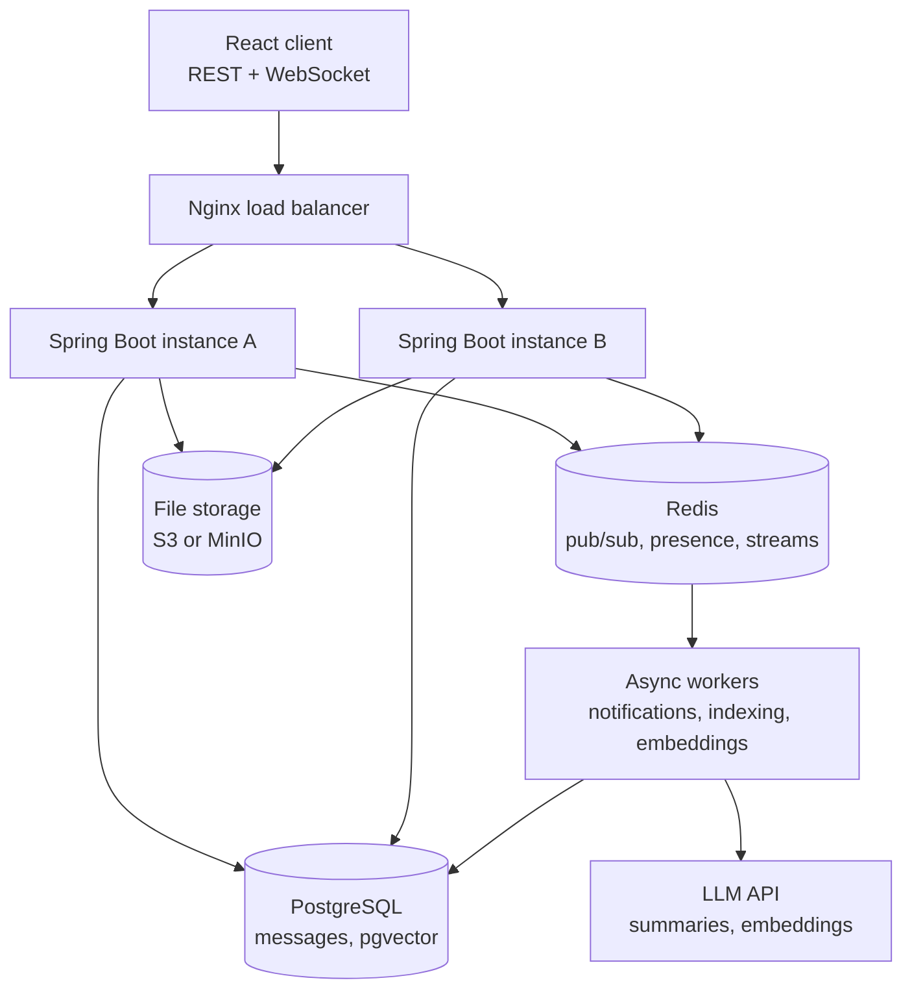

# Slack-like Team Collaboration Platform: Project Plan

## 1. What this project is

A Slack-style real-time team messaging platform with AI features. Built in Java (Spring Boot) with a React client. The goal is a resume project for a Backend SDE-1 role, so the emphasis is backend correctness and scalability: horizontally scaled WebSocket servers, reliable delivery, ordering, idempotency, reconnect-and-replay, async workers, and measured load-test results.

Owner context: CS student, target role Backend SDE-1. Tools already known: GitHub, VS Code, Antigravity. Needs exact step-by-step tasks, not general advice.

## 2. What it does

**Users can**
- Sign up, log in, create or join workspaces with roles (owner, admin, member)
- Chat in public channels, private channels, and DMs
- Use threads, reactions, mentions, edit and delete
- See typing indicators, online presence, unread counts
- Search messages and upload files

**AI features**
- "Catch me up": summarize a long thread or unread channel activity
- Semantic search over messages (embeddings in pgvector)
- Optional: extract action items and decisions

## 3. Tech stack

| Layer | Choice |
|---|---|
| Backend | Java 21, Spring Boot (Web, Security, Data JPA, WebSocket/STOMP, Validation) |
| Database | PostgreSQL, Flyway migrations, pgvector for embeddings |
| Cache, presence, pub/sub, queue | Redis (pub/sub, TTL keys, Redis Streams) |
| Files | S3 or MinIO with presigned URLs |
| Auth | Spring Security, JWT |
| Load balancer | Nginx |
| Frontend | React, Vite, TypeScript, TanStack Query, Zustand, @stomp/stompjs |
| Observability | Micrometer, Prometheus, Grafana |
| Testing | JUnit 5, Testcontainers, Gatling or k6 |
| CI/CD | GitHub Actions, Docker, Docker Compose |
| AI | LLM API for summaries and embeddings |

## 4. Architecture diagram



Text version of the same diagram:

```
Client (React)
   |  REST + WebSocket
   v
Nginx load balancer
   |-----------------------|
   v                       v
Spring Boot A         Spring Boot B      (REST + WebSocket/STOMP, stateless)
   |                       |
   +-----------+-----------+
               |
   +-----------+-------------+
   v           v             v
Redis      PostgreSQL     File storage
(pub/sub,  (messages,     (S3 / MinIO)
presence,  pgvector)
streams)
   |
   v
Async workers --> LLM API (summaries, embeddings)
   |
   v
PostgreSQL (results)
```

## 5. Message flow (sending a message)

1. Client generates a `clientMessageId` (UUID) and sends the message over REST or WebSocket. Nginx routes it to one app instance.
2. The instance checks permissions, then **persists the message to PostgreSQL first** (durable before delivery). Duplicate `clientMessageId` for the same channel is ignored (idempotent).
3. The instance assigns a per-channel sequence number and publishes an event to Redis pub/sub.
4. Every instance subscribed to that channel receives the event and pushes it to its own connected WebSocket clients. This is how a user on instance B sees a message sent via instance A.
5. Slow work goes to a Redis Stream: notifications, search indexing, embeddings. Workers consume it and call the LLM API. AI calls never block message delivery.

**Reconnect and replay:** the client remembers `lastSeenId` per channel. After a reconnect it calls `GET /channels/{id}/messages?after=lastSeenId`, merges by message ID (deduplicating), then resumes live events.

## 6. Hard problems and the planned solution

| Problem | Solution |
|---|---|
| Delivery across server instances | Redis pub/sub between instances |
| Ordering within a channel | Per-channel monotonic sequence number |
| Duplicates after retries | Client-generated message ID plus unique constraint on (channel, clientMessageId) |
| Lost messages on disconnect | Reconnect with `lastSeenId`, server replays the gap |
| Unread counts | Per-user per-channel read cursor; unread = messages after cursor |
| Presence at scale | Heartbeats in Redis with TTL, throttled broadcast |
| Abuse and floods | Token-bucket rate limiting in Redis |
| Slow side effects | Async workers via Redis Streams |

## 7. Proposed data model (draft, refine in T1.1)

- `users` (id, email, password_hash, display_name, created_at)
- `workspaces` (id, name, owner_id, created_at)
- `workspace_members` (workspace_id, user_id, role)
- `channels` (id, workspace_id, name, type: public/private/dm, created_at)
- `channel_members` (channel_id, user_id, last_read_message_id)
- `messages` (id, channel_id, seq, user_id, client_message_id, parent_id, body, created_at, edited_at, deleted_at); unique (channel_id, client_message_id); unique (channel_id, seq)
- `reactions` (message_id, user_id, emoji)
- `files` (id, message_id, storage_key, name, size)
- `message_embeddings` (message_id, embedding vector)

## 8. Client design summary

- Folders: `api/` (REST), `realtime/` (STOMP and reconnect), `store/` (Zustand), `components/`, `pages/`
- REST for loading (history, channels, search); one STOMP connection for live events
- JWT attached to REST calls and STOMP connect headers
- Optimistic send with `clientMessageId`; message shown as "sending" until the server echo arrives
- Cursor-based pagination (`before=` and `after=` message ID), never page numbers
- Sort by server sequence number, key by server message ID
- Unsubscribe when switching channels; throttle typing events to one per 2 to 3 seconds
- Build order: REST-only UI, then STOMP live receive, then optimistic send, then reconnect and replay, then typing, presence, unread badges

## 9. Feature list by phase

**Phase 1: Foundation.** Auth (JWT), workspaces, invites, channels, DMs, membership, roles.
**Phase 2: Real-time core.** WebSocket messaging, history pagination, threads, edit and delete, reactions, mentions, typing, presence, unread counts.
**Phase 3: Backend depth.** Multi-instance with Nginx and Redis pub/sub, idempotent sends, ordering, reconnect and replay, rate limiting, async workers, full-text search, file uploads.
**Phase 4: Optional extras (pick one or two).** Notifications, pinned or saved messages, scheduled messages, slash commands, webhooks, link unfurling.
**Phase 5: AI.** Thread summary, catch-me-up, semantic search, optional action-item extraction.
**Phase 6: Production quality.** Testcontainers integration tests, load tests, metrics dashboards, CI/CD, live demo, README.

## 10. Task plan (about 8 weeks; update checkboxes as tasks finish)

### Phase 0: Setup (Day 1)
- [x] T0.1 Install JDK 21, Maven, Docker Desktop, Postman. VS Code: Extension Pack for Java, Spring Boot Extension Pack.
- [x] T0.2 Create GitHub repo `slack-clone` with README, Java `.gitignore`, folders `backend/` and `frontend/`.
- [x] T0.3 Generate backend at start.spring.io (Maven, Java 21; Web, Security, Data JPA, PostgreSQL Driver, WebSocket, Validation, Flyway, Lombok) into `backend/`.
- [x] T0.4 Write `docker-compose.yml` for Postgres and Redis; run `docker compose up -d`.
- [x] T0.5 Connect the app to Postgres, confirm it starts, commit. Done when `GET /health` returns OK.

### Phase 1: Auth and workspaces (Week 1)
- [x] T1.1 Design the schema on paper; write Flyway migrations.
- [x] T1.2 Signup and login with BCrypt and JWT.
- [x] T1.3 Workspace creation, invites, membership with roles.
- [x] T1.4 Integration tests for auth using Testcontainers.

### Phase 2: Channels and messaging over REST (Week 2)
- [x] T2.1 Channels: create, join, list (public and private), DMs.
- [ ] T2.2 Messages: send, fetch history with cursor pagination.
- [ ] T2.3 Permission checks (only members read or post).
- [ ] T2.4 Tests for each endpoint. Done when a full chat works through REST alone.

### Phase 3: Real-time (Weeks 3 to 4)
- [ ] T3.1 WebSockets (Spring WebSocket + STOMP) authenticated with JWT.
- [ ] T3.2 Persist first, then broadcast to channel subscribers.
- [ ] T3.3 Minimal React client: login, channel list, message view, composer.
- [ ] T3.4 Presence and typing indicators (Redis heartbeats with TTL).
- [ ] T3.5 Read cursors and unread counts.
- [ ] T3.6 Threads, edit and delete, reactions, mentions. Done when two browser tabs chat live.

### Phase 4: Backend depth (Weeks 5 to 6, main resume value)
- [ ] T4.1 Two instances behind Nginx; cross-instance delivery via Redis pub/sub. Demo it.
- [ ] T4.2 Idempotent sends with client message ID.
- [ ] T4.3 Reconnect and replay with `lastSeenId`.
- [ ] T4.4 Per-channel ordering with sequence numbers.
- [ ] T4.5 Rate limiting (token bucket in Redis).
- [ ] T4.6 Async jobs via Redis Streams (notifications, indexing).
- [ ] T4.7 Message search (Postgres full-text). Done when killing one instance mid-conversation loses no messages.

### Phase 5: AI features (Week 7)
- [ ] T5.1 Thread summary endpoint.
- [ ] T5.2 Catch-me-up: summarize unread channel activity.
- [ ] T5.3 Semantic search: async embeddings into pgvector, similarity query.
- [ ] T5.4 Optional: action-item extraction.

### Phase 6: Production quality (Week 8)
- [ ] T6.1 GitHub Actions CI (build and test on every push).
- [ ] T6.2 Load test with Gatling or k6: concurrent connections, messages per second, p95 delivery latency.
- [ ] T6.3 Metrics (Micrometer, Prometheus, Grafana screenshot).
- [ ] T6.4 Live demo on a small VM or free-tier host, plus a 2-minute backup video.
- [ ] T6.5 README: architecture diagram, design decisions, load test numbers, demo link.

## 11. Working rules for this project

- One task at a time, in T-number order. After each task, give the exact next task.
- Explain what code does; the owner must be able to explain every part in an interview.
- Only claim measured numbers on the resume.
- Cut scope from Phase 5 and Phase 4 first if time is short; never cut Phases 1 to 3 and the core of Phase 4 (T4.1 to T4.4).
- Free hosting rarely supports long-lived WebSockets plus Redis plus Postgres well; decide the demo deployment early.

## 12. Resume line (fill in measured values later)

"Built a horizontally scalable team messaging platform (Spring Boot, WebSocket/STOMP, Redis pub/sub, PostgreSQL) with idempotent delivery, reconnect replay, and AI thread summaries and semantic search; load-tested to N concurrent connections at p95 < X ms."
